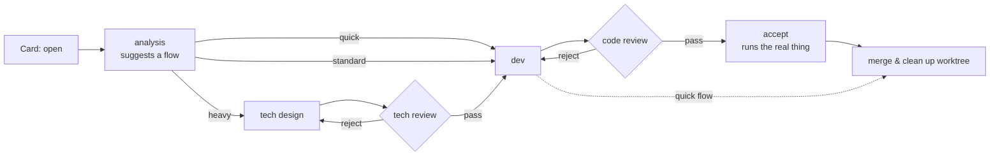

<div align="center">

# Loop Engine

**Your AI dev team on a kanban board.**
Agents that plan, code, review each other, and refuse to merge bad work.

[English](README.md) · [简体中文](README.zh-CN.md)

[](https://github.com/RonSpeace/loop-engine/actions/workflows/ci.yml)


</div>

<!-- SCREENSHOT: board overview from a real project (to be added) -->

---

Most coding agents are a single, very confident engineer. Loop Engine gives them a **process**:
you drop a requirement card on the board, and a pipeline of role-specialised agents picks it up —
analysis → design → design review → development → code review → acceptance testing → merge.

Reviewers are read-only and can **reject**. Rejected work goes back for a redo. Misconfiguration,
missing verdicts or failed exit checks **stop the line** instead of merging something half-done.
Every card is developed in its own git worktree and merged only when every gate has passed.

> Loop Engine is built with Loop Engine. Most of this repository's history was planned,
> implemented, reviewed and merged by its own pipeline.

## Why Loop Engine

| | Single coding agent | Loop Engine |
|---|---|---|
| Who checks the work? | The same agent that wrote it | Separate, read-only reviewer roles with a pass/reject verdict |
| What happens on a bad result? | You find out later | Card is rejected and redone automatically; after repeated rejections it escalates to a human |
| Isolation | Your working copy | One git worktree + branch per requirement, merged at the end |
| Process | Whatever the prompt says | Flows defined in `flows.json`, prompts in `prompts/*.md` — versioned, reviewable config |
| Failure mode | Optimistic | Fail-closed: unknown role, invalid config or missing verdict → stop and wait for a human |

## How it works



- **Board** (`board.py`, Flask + SQLite) — requirement cards, live agent session timeline, artifacts, diffs, chat with any running session.
- **Dispatcher** (`dispatcher.py`) — polls open cards, creates worktrees, drives agents over the
  [Agent Client Protocol (ACP)](https://agentclientprotocol.com), enforces gates, retries, escalation and merging.
- **Flows are config** — three built-in flows (`quick`, `standard`, `heavy`); add a role by adding
  it to `flows.json`, a capability entry, and a `prompts/<role>.md`.
- **Role capabilities are enforced, not suggested** — read-only roles get a restricted tool set and a
  Bash allow-list; dev can only write inside its worktree; accept can run tests but not commit.

## Features

- Multi-role pipeline with review gates, automatic redo, model escalation on repeated rejection, and human hand-off
- Per-requirement git worktrees, automatic `--no-ff` merge, conflict-resolution role, optional push / branch-only mode for PR-based repos
- Browser-level verification for UI changes (Playwright MCP) in dev and acceptance roles
- Per-role and per-project model selection with a 4-level fallback chain; works with any provider your agent runtime supports
- Live session view: tool calls, thoughts, diffs, token usage, cost and rejection stats per project
- Human-in-the-loop by design: `need_confirm` questions answered from the board (or Feishu/Lark IM, optional)
- Notifications to Slack, any webhook (HMAC-signed JSON) or Feishu when a card needs you, finishes or fails
- Multi-project: one board, many repositories, parallel agents per project
- English and Chinese UI (follows your browser language; toggle in the header)

## Quick start

**Requirements:** Python 3.11+, git, and at least one ACP agent runtime (see below).

```bash
git clone https://github.com/RonSpeace/loop-engine.git && cd loop-engine
python3 -m venv .venv && .venv/bin/pip install -r requirements.txt

cp projects.example.json projects.json      # point it at a git repo you want agents to work on
.venv/bin/python scripts/doctor.py           # environment self-check
./scripts/run_local.sh                       # starts the board + dispatcher (Ctrl-C stops both)
```

Open <http://127.0.0.1:8899>, create a card with status **open**, and watch it move through the flow.

The full walkthrough — model / API key setup, MCP tools, a toy project for your first end-to-end loop,
and troubleshooting — is in [docs/quickstart.en.md](docs/quickstart.en.md) ([简体中文](docs/quickstart.md)).

### Agent runtimes

Each role runs on an ACP agent runtime, chosen per role and per project:

| Runtime | Roles | Notes |
|---|---|---|
| `kimi` (default) | all | kimi-code CLI (`kimi acp`); point it at any OpenAI / Anthropic / Gemini-compatible model |
| `claude-code` | dev | Claude Code via `@zed-industries/claude-code-acp`; uses your logged-in `claude` CLI |
| `codex` | dev | Codex via `@zed-industries/codex-acp`; uses your logged-in `codex` CLI |

```json
{"my-project": {"paths": ["/path/to/repo"], "runtimes": {"dev": "claude-code"}}}
```

Selection order: `projects.json` `<project>.runtimes.<role>` → `<project>.runtime` → `flows.json`
`roles.<id>.runtime` → `LOOP_AGENT_RUNTIME` → `kimi`. Unknown runtimes are refused before anything starts.

Claude Code and Codex are limited to the **dev** role for now: Loop Engine re-checks every command and
file write they ask to run, but it can't yet prove the read-only limits of the reviewer roles hold on
those runtimes, so it refuses to start them there rather than run them unconstrained.
Details: [docs/quickstart.md](docs/quickstart.md#agent-runtimes运行体选择).

### Linux

Everything runs on Linux with `scripts/run_local.sh` (launchd and `start.sh` are macOS-only).
Logs written by the scripts default to `$XDG_STATE_HOME/loop-engine/logs`
(`~/.local/state/loop-engine/logs`); set `REQ_BOARD_LOG_DIR` to change it. The **Choose folder**
button in the project dialog uses `zenity` or `kdialog` when a desktop session is available;
otherwise it hides itself and you type the repository path.
For a long-running service, wrap `scripts/run_local.sh` in a systemd user unit or use Docker.

### Docker

```bash
mkdir -p config && cp projects.example.json config/projects.json   # paths = paths under LOOP_REPOS
LOOP_UID=$(id -u) LOOP_GID=$(id -g) LOOP_REPOS=$HOME/code docker compose up --build
```

The compose file runs the board and the dispatcher in one container, keeps the database in a named
volume, mounts `config/` (`projects.json`, `feishu.json`), `~/.req-board` state and your repositories
(at the same path as on the host), and publishes the board on `127.0.0.1:8899` only. Uncomment the
volume for your agent runtime's login (`~/.kimi-code-deepseek`, `~/.claude`, `~/.codex`).

> **Security:** the board has **no authentication** — anyone who can reach it can edit cards and make
> agents change your code. It listens on `127.0.0.1` unless `REQ_BOARD_HOST` is set; the compose file
> sets `REQ_BOARD_HOST=0.0.0.0` only so Docker can forward the port, and binds that port to the host's
> loopback. Never publish it on `0.0.0.0` or an untrusted network.

## Configuration at a glance

| File | Purpose |
|---|---|
| `flows.json` | Pre-step, flows (node sequences), role display names, per-role models and skills |
| `prompts/*.md` | Role prompt templates; `prompts/skills/` holds reusable scenario snippets |
| `projects.json` | Your projects: repo paths, base branch, goal, git sync, restart recipe (local, gitignored) |
| `.loop/` in each repo | Per-project conventions injected into prompts: test commands, guides, high-risk paths |
| `.env` | Optional overrides (ports, model, agent binary) — see `.env.example` |

## Documentation

- [Quick start](docs/quickstart.md) · [Dispatcher internals](docs/dispatcher.md) · [REST API](docs/api.md)
- [Data model](docs/data-model.md) · [Project manifest & prompt layers](docs/project-manifest.md)
- [Contributor conventions](AGENTS.md) — the same rules the agents follow when working on this repo

## Roadmap

- [x] Pluggable agent runtimes: Claude Code and Codex for the dev role
- [ ] Claude Code / Codex for reviewer roles, Gemini CLI
- [x] English UI
- [ ] English prompt set
- [x] Docker Compose
- [ ] One-command install
- [ ] GitHub Issues ⇄ cards sync, PR mode
- [ ] Shareable card replays (timeline of a requirement from card to merge)
- [ ] Community flow templates

## Contributing

Issues and pull requests are welcome. Please read [CONTRIBUTING.md](CONTRIBUTING.md) first.
Run the test suite with:

```bash
.venv/bin/pip install -r requirements-dev.txt
.venv/bin/python -m pytest -q tests
```

## License

[MIT](LICENSE)
