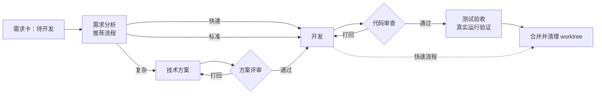

<div align="center">

# Loop Engine

**一张看板，一支会互相审查的 AI 研发团队。**
会做方案、会写代码、会互相打回，不合格的代码不合并。

[English](README.md) · [简体中文](README.zh-CN.md)


</div>

<!-- SCREENSHOT: 真实项目的看板总览（待补） -->

---

大多数编码 agent 是一个「非常自信的工程师」。Loop Engine 给它们一套**流程**：
你在看板上建一张需求卡，一条由不同角色 agent 组成的流水线接手——
需求分析 → 技术方案 → 方案评审 → 开发 → 代码审查 → 测试验收 → 合并。

评审角色只读，可以**打回**；打回的活自动重做。配置非法、评审结论缺失、收尾校验不过，一律**停线**等人处理，
绝不把半成品合进主干。每张卡在独立 git worktree 里开发，所有关卡通过后才合并。

> Loop Engine 用 Loop Engine 开发。本仓库的大部分历史，是由它自己的流水线分析、实现、审查并合并的。

## 为什么用 Loop Engine

| | 单个编码 agent | Loop Engine |
|---|---|---|
| 谁来检查？ | 写代码的同一个 agent | 独立的只读评审角色，给出通过/打回结论 |
| 结果不合格？ | 事后才发现 | 自动打回重做；多次打回自动升级模型，再不行转人工 |
| 隔离 | 你的工作区 | 每张需求一个 worktree + 分支，最后合并 |
| 流程 | 提示词怎么写就怎么跑 | `flows.json` 定义流程、`prompts/*.md` 定义角色，可版本化、可评审 |
| 失败方式 | 乐观推进 | fail-closed：角色未知/配置非法/缺结论 → 停下等人 |

## 工作方式



- **看板**（`board.py`，Flask + SQLite）：需求卡、agent 会话实时时间线、产物、diff，可和任意运行中的会话对话。
- **调度器**（`dispatcher.py`）：轮询待开发的卡，建 worktree，经 [ACP 协议](https://agentclientprotocol.com) 驱动 agent，执行关卡、重试、升级与合并。
- **流程即配置**：内置快速 / 标准 / 复杂三条流程；新增角色 = 改 `flows.json` + 角色能力表 + 新增 `prompts/<角色>.md`。
- **角色权限是强制的**：只读角色只拿受限工具和 Bash 白名单；开发只能写自己的 worktree；验收能跑测试但不能提交。

## 功能

- 多角色流水线：评审关卡、自动重做、多次打回升级模型、转人工
- 每张需求独立 worktree，自动 `--no-ff` 合并，冲突解决角色，可选推送 / 仅推分支模式（适合走 PR 的仓库）
- 界面改动做浏览器级验证（Playwright MCP），开发与验收角色都适用
- 按角色、按项目选模型，四层兜底链；agent 运行体支持的厂商都能用
- 会话实时视图：工具调用、思考、diff、token 用量，按项目统计消耗与打回率
- 人在回路：agent 的确认提问在看板上答复（可选接飞书机器人）
- 多项目：一个看板管多个仓库，每个项目并行多个 agent
- 中英双语界面（跟随浏览器语言，页头可切换）

## 快速开始

**依赖**：Python 3.11+、git，以及至少一个 ACP agent 运行体（见下文）。

```bash
git clone https://github.com/RonSpeace/loop-engine.git && cd loop-engine
python3 -m venv .venv && .venv/bin/pip install -r requirements.txt

cp projects.example.json projects.json      # 指向你要让 agent 开发的 git 仓库
.venv/bin/python scripts/doctor.py           # 环境自检
./scripts/run_local.sh                       # 同时启动看板 + 调度器（Ctrl-C 全停）
```

打开 <http://127.0.0.1:8899>，建一张状态为「待开发」的卡，看它走完流程。

完整指南（模型与 API KEY 配置、MCP 工具、用玩具项目跑通第一条闭环、排障）见 [docs/quickstart.md](docs/quickstart.md)。

### Agent 运行体

每个角色跑在一个 ACP agent 运行体上，可按角色、按项目选择：

| 运行体 | 可用角色 | 说明 |
|---|---|---|
| `kimi`（默认） | 全部 | kimi-code CLI（`kimi acp`），可接任意 OpenAI / Anthropic / Gemini 兼容模型 |
| `claude-code` | 开发 | 经 `@zed-industries/claude-code-acp` 接 Claude Code，用你已登录的 `claude` CLI |
| `codex` | 开发 | 经 `@zed-industries/codex-acp` 接 Codex，用你已登录的 `codex` CLI |

```json
{"my-project": {"paths": ["/path/to/repo"], "runtimes": {"dev": "claude-code"}}}
```

选择顺序：`projects.json` 的 `<项目>.runtimes.<角色>` → `<项目>.runtime` → `flows.json` 的
`roles.<id>.runtime` → `LOOP_AGENT_RUNTIME` → `kimi`。未知运行体在启动前就会被拒绝。

Claude Code 和 Codex 目前只开放给**开发**角色：Loop Engine 会复核它们申请执行的每条命令和每次写文件，
但还不能证明评审类角色的只读限制在这两个运行体上同样生效，所以宁可拒绝启动，也不在没有约束的情况下运行。
详见 [docs/quickstart.md](docs/quickstart.md#agent-runtimes运行体选择)。

## 配置一览

| 文件 | 作用 |
|---|---|
| `flows.json` | 前置环节、流程节点序列、角色展示名、按角色的模型与技能 |
| `prompts/*.md` | 角色提示词模板；`prompts/skills/` 是可复用的场景片段 |
| `projects.json` | 你的项目：仓库路径、主干分支、项目目标、git 同步、重启配方（本地文件，不入库） |
| 各仓库的 `.loop/` | 注入提示词的项目约定：测试命令、指引、高风险路径 |
| `.env` | 可选覆盖（端口、模型、agent 路径），见 `.env.example` |

## 文档

- [快速开始](docs/quickstart.md) · [调度器详解](docs/dispatcher.md) · [REST API](docs/api.md)
- [数据模型](docs/data-model.md) · [项目清单与提示词分层](docs/project-manifest.md)
- [贡献约定](AGENTS.md)：agent 开发本仓库时遵守的同一套规则

## 路线图

- [x] 可插拔 agent 运行体：开发角色支持 Claude Code、Codex
- [ ] 评审类角色支持 Claude Code / Codex，接入 Gemini CLI
- [x] 英文界面
- [ ] 英文提示词
- [ ] 一条命令安装与 Docker Compose
- [ ] GitHub Issues 与需求卡双向同步、PR 模式
- [ ] 可分享的需求回放（从建卡到合并的完整时间线）
- [ ] 社区流程模板

## 参与贡献

欢迎提 Issue 和 PR，请先读 [CONTRIBUTING.md](CONTRIBUTING.md)。运行测试：

```bash
.venv/bin/pip install -r requirements-dev.txt
.venv/bin/python -m pytest -q tests
```

## 许可证

[MIT](LICENSE)
